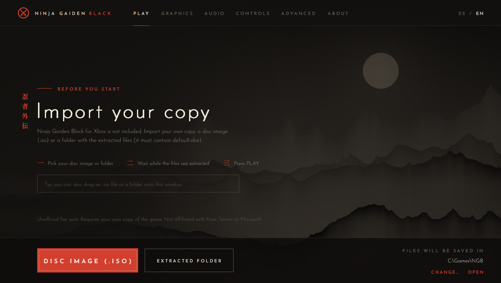

# Ninja Gaiden Black: native PC port

[](https://github.com/angeldev07/ninja-gaiden-black-port/actions/workflows/ci.yml)
[](https://github.com/angeldev07/ninja-gaiden-black-port/releases/latest)
[](LICENSE)

An unofficial fan project that runs **Ninja Gaiden Black** (original Xbox, 2005) natively on Windows, with no CPU
emulator: the game's own x86 code runs inside a 32-bit Win32 process, on top of a reimplemented Xbox kernel, an NV2A →
OpenGL renderer and an APU audio engine.

> **You need your own copy of the game.** This repository and its releases contain no game data, no game assets and
> nothing from the Microsoft XDK. Each player imports the files of their own disc.



## Features

- **Plays the game:** the whole story mode, from the title screen to the ending, with saves, music, voices and
  effects at 60 fps.
  The PAL (European) and NTSC-U (North American) releases are supported.
- **Sharper than the console:** the internal resolution goes up to 4x, with *Match my screen* rendering at your
  monitor's resolution. Textures get 16x anisotropic filtering.
- **Native widescreen:** the game's own 16:9 mode (a wider field of view, not a stretch), borderless fullscreen and
  Alt+Enter.
- **Gamepad and keyboard:** any XInput gamepad, and the keyboard at the same time.
- **A launcher that does the rest:**
  - it imports your disc image (Redump or XISO) or an extracted folder, and checks that it is the right game;
  - it updates itself;
  - it has English and Spanish UI.

## Play

1. Download the zip of the [latest release](https://github.com/angeldev07/ninja-gaiden-black-port/releases/latest)
   and unzip it.
2. Run `ngb-launcher.exe`. If Windows shows **"Windows protected your PC"**, see
   [the SmartScreen note](#windows-smartscreen) below.
3. Click **Import game** and pick the image of your disc.
4. Click **PLAY**.

The **[getting started guide](docs/guide/getting-started.md)** covers each step in detail, including what the launcher
accepts from your own copy, the controls, where saves live, the settings, updates and troubleshooting.

### Windows SmartScreen

The first time you run the launcher, Windows may show **"Windows protected your PC"** or call it an unrecognized
app. **It is not a virus detection.** SmartScreen warns about any program that is not code-signed and that few
people have downloaded yet. It does not look at what the program does. The port's binaries are not signed yet.

- **To run it:** click **More info**, then **Run anyway**. Windows asks only once per version.
- **Or, before unzipping:** right-click the zip, choose **Properties**, tick **Unblock**, click **OK**, then unzip.
- **To check what you downloaded:**
  - every release is built by GitHub Actions from a tagged commit of this repository;
  - its `ngb-update.txt` lists the zip's SHA-256. In PowerShell, `Get-FileHash ngb-port-*.zip` must print the same
    value.
- **If your antivirus quarantines a file,** please
  [open an issue](https://github.com/angeldev07/ninja-gaiden-black-port/issues/new/choose) with the detection name, and
  report it to the vendor as a false positive. For Microsoft Defender that is
  [microsoft.com/wdsi/filesubmission](https://www.microsoft.com/wdsi/filesubmission).

Code-signing the releases, which removes most of these warnings, is planned.

## Status

v0.5.0 has been played through the whole story mode, from the title screen to the ending. It plays well overall,
with an occasional glitch. Known gaps:

- Some lighting details still differ from the console.
- Floor reflections and the sword glow are missing.
- Some in-game cutscenes and fights with many enemies drop below 60 fps.
- Under the heat haze over the lava, a thin dark band can show at the right edge of the screen.
- In the mission mode the game closed once with an exception, after almost three hours of play. It is under
  investigation.

The [roadmap](docs/target/roadmap.md) lists what is next, and the [development log](docs/log.md) records every step.
Compatibility reports for the mission mode, for both releases and for the Japanese one are very welcome.

## Building from source

Requirements: Visual Studio 2022 with the C++ x86 toolset, and Python 3.13 for the tools and tests (standard library
only).

```bat
port\build.cmd
python -m unittest discover -s tests -v
```

`build.cmd` compiles with `/W4 /WX` and runs the C unit tests. The binaries end up in `build\port\`:

| Binary | What it is |
| --- | --- |
| `ngb-launcher.exe` | The launcher (Win32 + GDI) |
| `ngb-loader.exe` | The loader that maps the game's XBE |
| `ngb-core.dll` | The kernel, GPU and APU |

Releases are built by GitHub Actions from a tag; see [ADR-07](docs/target/adr-07-releases-and-updater.md).

## How it works

| Path | Contents |
| --- | --- |
| `port/` | The native runtime in C: XBE loader, HLE kernel, NV2A/OpenGL renderer, APU, input, launcher |
| `src/ngb_tools/` | Python tools: reverse engineering (AFS, XPR, KMD, audio, XBE), the game-data guard, release packaging |
| `tests/` | Python unit tests (the C tests live in `port/tests/`) |
| `docs/` | The project's knowledge base (an Obsidian vault): formats, reverse-engineering notes, decisions |

Start with [`docs/GOAL-ngb-port.md`](docs/GOAL-ngb-port.md) and [`docs/index.md`](docs/index.md).

## Contributing

Contributions are welcome: compatibility reports, bug reports, code and reverse-engineering notes. Read
[CONTRIBUTING.md](CONTRIBUTING.md) first. It has the build, the workflow and the **mandatory legal rules**: no game data,
no XDK, and a DCO sign-off on every commit. Everyone taking part follows the [Code of Conduct](CODE_OF_CONDUCT.md).
Security issues go through [SECURITY.md](SECURITY.md).

## Credits

By **angeldev07** and [contributors](https://github.com/angeldev07/ninja-gaiden-black-port/graphs/contributors).

The port stands on public work by others:

- [xemu](https://github.com/xemu-project/xemu): the NV2A and APU behavior;
- [nxdk](https://github.com/XboxDev/nxdk): the kernel export list;
- [Cxbx-Reloaded](https://github.com/Cxbx-Reloaded/Cxbx-Reloaded) and [XboxDevWiki](https://xboxdevwiki.net/): XBE,
  kernel and hardware documentation;
- [envytools](https://github.com/envytools/envytools): NV2A documentation;
- [RenderDoc](https://renderdoc.org/): the capture API header.

[THIRD_PARTY.md](THIRD_PARTY.md) has the full list and the licenses.

## License

[GPL-3.0-or-later](LICENSE).

## Legal

Ninja Gaiden is a trademark of Koei Tecmo. Xbox and Windows are trademarks of Microsoft. This project is not affiliated
with or endorsed by Koei Tecmo, Team Ninja or Microsoft, and it is non-commercial: it accepts no donations or payments.

No game data is distributed. The `ngb-hygiene` guard (a pre-commit hook, CI and the release packaging) blocks game
files from entering the repository or a release. The Xbox kernel declarations come from public sources (nxdk, CC0),
never from the leaked XDK.
