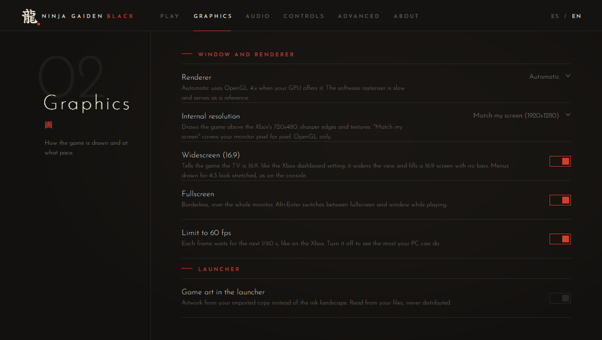

# Getting started: from zero to playing

This guide takes you from nothing to playing Ninja Gaiden Black on your PC with the launcher. It assumes no
technical knowledge. If something goes wrong, see [Troubleshooting](#troubleshooting).

> **You need your own copy of the game.** The port contains no game data. It runs the files of *your* Ninja Gaiden
> Black disc. This project never links to downloads of the game, and its issue tracker removes them.

## 1. What you need

- **Windows 10 (version 1803 or later) or Windows 11.**
- **A graphics card with an up-to-date driver that supports OpenGL 4.6.** Any AMD, NVIDIA or Intel GPU from the last
  several years does. Without it the launcher falls back to a software renderer, which works but is very slow.
- **About 7 GB of free disk space** for the game files.
- **A gamepad is recommended.** Any XInput gamepad works, such as an Xbox controller. The keyboard also works, but it
  has no right stick for the camera.
- **A disc image of your own Ninja Gaiden Black (original Xbox) disc.** See the next step.

The port runs the **PAL (European)** and the **NTSC-U (North American)** releases. It is developed mostly with the
PAL one. The Japanese release is untested: if you try it, a
[compatibility report](https://github.com/angeldev07/ninja-gaiden-black-port/issues/new/choose) helps.

## 2. Bring your own copy

The port runs the files of a Ninja Gaiden Black disc that **you own**. Whether you may make a personal backup of it
depends on the law where you live: check it first. This guide is not legal advice.

The launcher accepts any of these, made from your own disc:

- a disc image (`.iso`, Redump or XISO);
- a folder with the game's files, containing `default.xbe`.

Original Xbox discs cannot be read by an ordinary PC DVD drive. The Xbox homebrew community documents how owners
make backups of their own discs; this project does not provide tools or downloads for it.

## 3. Install the launcher

1. Download `ngb-port-vX.Y.Z-win32.zip` from the
   [latest release](https://github.com/angeldev07/ninja-gaiden-black-port/releases/latest).
2. Unzip it into a folder you can write to, for example `C:\Games\NGB-Port`. Avoid `C:\Program Files`: the launcher
   keeps its settings (`ngb.ini`) next to itself and updates itself there.
3. Run `ngb-launcher.exe`.

**"Windows protected your PC" (SmartScreen):** this is not a virus detection.
- **Why:** SmartScreen warns about any program that is not code-signed and that few people have downloaded yet. The
  port's binaries are not signed yet.
- **To run it:** click **More info**, then **Run anyway**. Or, before unzipping, right-click the zip, choose
  **Properties**, tick **Unblock**, then unzip.
- **The source:** the source code of every binary is in this repository, and each release is built by GitHub Actions
  from a tagged commit.
- **Antivirus:** some antivirus programs also flag unsigned programs that download updates. If yours does:
  - check the zip with `Get-FileHash` in PowerShell against the SHA-256 in the release's `ngb-update.txt`;
  - report the false positive to the vendor (for Defender: microsoft.com/wdsi/filesubmission) and open an issue with
    the detection name.

## 4. Import your game

1. On the **Play** page, click **Disc image (.iso)** or **Extracted folder** and pick your copy. You can also drag the
   file or the folder onto the window.
2. The launcher checks that it is Ninja Gaiden Black. A different game, or a damaged image, is refused with the
   reason.
3. An image is extracted into the data folder shown at the bottom right. By default that is `%LOCALAPPDATA%\NGBPort`.
   **Change…** points the launcher at another folder before you import. It does not move files that are already
   there, saves included. An extracted folder is used where it is, without copying.

Extracting takes a few minutes. You can cancel at any time, and nothing half-copied is left behind.

## 5. Play

Click **PLAY** (or press Enter). The game opens in fullscreen at your screen's resolution.

| Key | Action |
| --- | --- |
| Alt+Enter | Switch between fullscreen and a window |
| F12 | Save a screenshot to the `runs\shots` folder of the data folder |

The **Controls** page shows the full keyboard and gamepad mapping. In short, for the keyboard:

- Enter is Start and A; Esc is Back and B;
- the arrows are the D-pad and WASD is the left stick;
- J, K, L and I are A, B, X and Y;
- Q and E are White and Black; U and O are the triggers.

The gamepad and the keyboard can be used at the same time.

**Your saves** live in the data folder, under `runs\hdd` (the Xbox hard disk). Back up that folder if you care about
them. Uninstalling the launcher does not touch it.

### Graphics settings

- **Internal resolution:** *Match my screen* renders at your monitor's resolution (on a 1080p screen, 1920x1280 with widescreen on and 1620x1080 without). 2x,
  3x and 4x render even sharper; 1x is the Xbox's own 720x480.
- **Widescreen (16:9):** tells the game the TV is 16:9, so it widens its field of view and fills the screen. The 2D
  menus are drawn for 4:3 and look stretched, as they did on the console. Turn it off for the original 4:3 picture
  with bars at the sides.
- **Limit to 60 fps:** the game's speed. Leave it on.
- **Game art in the launcher:** once your game is imported, the launcher can show the game's own key art and
  logotype, the emblem with Ryu's silhouette (also as the window icon), read from your copy while it runs. Nothing is copied or shared. It is on by default; turn it off for the
  launcher's own ink-wash art.

The launcher window can be maximized: everything is redrawn larger.

## 6. Updates

Once a day the launcher checks for a new release. When one is out, the Play page shows **Version X is available**:

- **What's new** opens the release notes;
- **Update** downloads it, checks it and restarts the launcher.

Your settings, your game files and your saves stay where they are. **Advanced > Check for updates** turns the check off.

## Troubleshooting

| Problem | What to do |
| --- | --- |
| SmartScreen or the antivirus blocks the launcher | See [step 3](#3-install-the-launcher). |
| "This is not Ninja Gaiden Black" | The launcher read a different title in the disc's executable. Check the image. |
| The image is refused as damaged or unreadable | Make the image again; a scratched disc gives read errors. |
| Black screen, or the game is extremely slow | Update the graphics driver. **Graphics > Renderer** should be *Automatic* or *OpenGL 4.x*. |
| Small stutters | Turn off **Advanced > RenderDoc capture**, or lower the internal resolution. |
| The game does not see the gamepad | It must be XInput (Xbox-style). Other gamepads need a tool such as Steam Input that presents them as XInput. |

**Reporting a bug:**

1. Go to **Advanced > Debugging** and click **Copy session info**.
2. Open a [bug report](https://github.com/angeldev07/ninja-gaiden-black-port/issues/new/choose) and paste it.
3. Attach the log: **View log**, then **Open runs folder**, then the newest `h6-*.log`. It is a few KB, and your
   Windows user name is already replaced with `%USERPROFILE%`.
4. Never attach game files, extracted assets or saves.

## FAQ

- **Is this legal?** The project contains only its own code, written without the game's data or the leaked Microsoft
  SDK, and you bring your own copy. This is not legal advice. See [THIRD_PARTY.md](../../THIRD_PARTY.md) and the Legal section of the
  [README](../../README.md).
- **Where do I get the game?** Buy a copy of the original Xbox release; the port only runs a disc you own.
  *Ninja Gaiden Master Collection* on Steam is *Ninja Gaiden Σ*, a different version, and it does not work with this
  port.
- **Does it run on Linux, macOS or a Steam Deck?** Only Windows is supported. Wine or Proton are untested.
- **Can I donate?** No. The project is non-commercial and accepts no money. Testing and reporting help a lot more.
